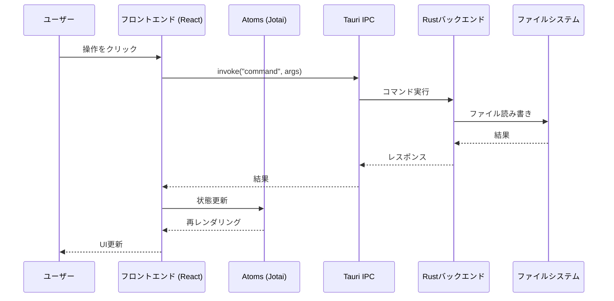
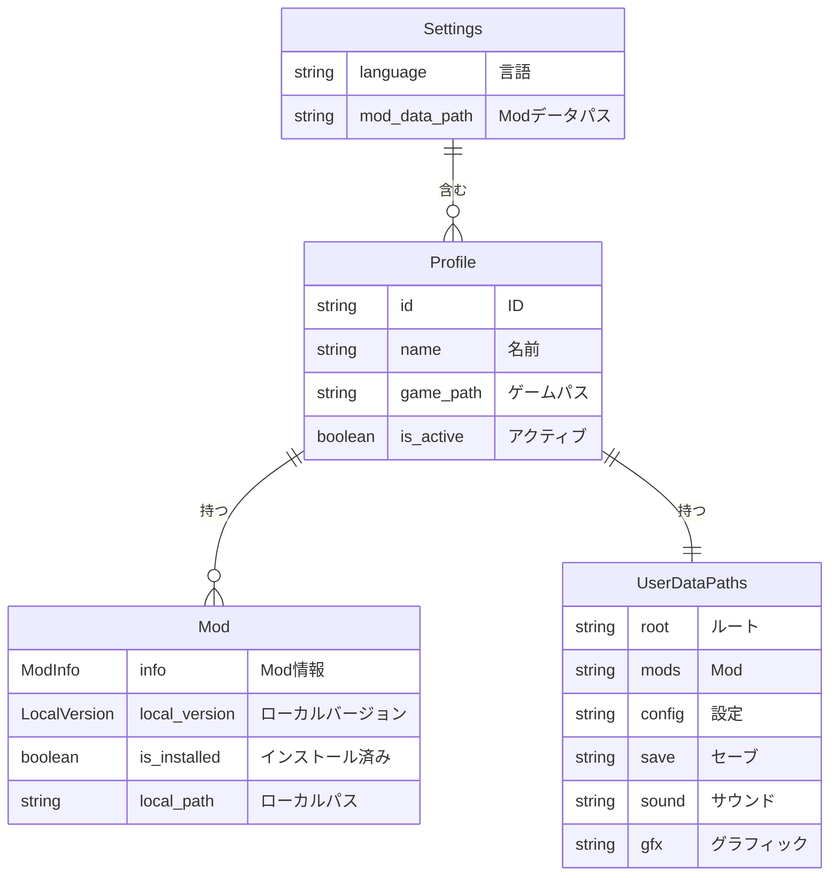
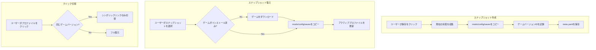
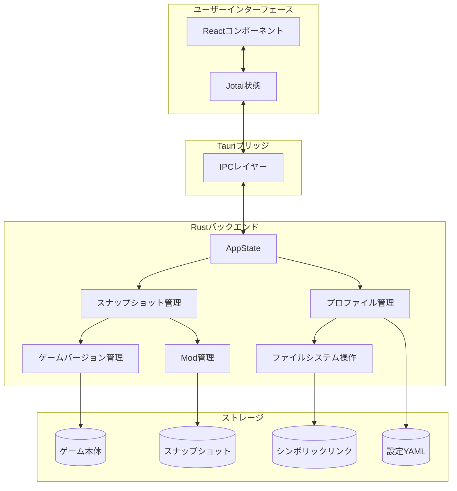
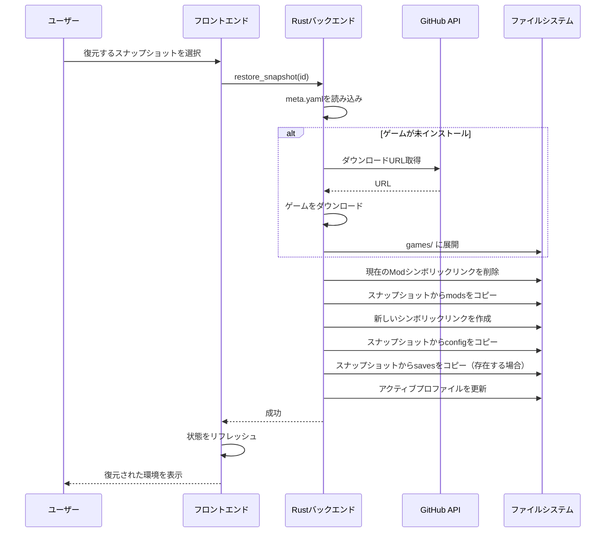

# Catalyzer アーキテクチャ

> **最終更新**: 2026-01-27
> **ステータス**: Draft
> **ビジョン**: [VISION.md](./VISION.md) を参照

---

## 1. 概要

Catalyzerは、Cataclysm: Dark Days Ahead (CDDA) 向けのMod管理ツール。
**Tauri 2** (Rustバックエンド) と **Next.js 14** (Reactフロントエンド) で構築されている。

### 設計原則

1. **シンプルさ最優先** - gitの知識は不要
2. **状態の明確表示** - 現在の環境が一目で分かる
3. **ワンクリック操作** - 保存・復元・切替を最小ステップで
4. **ストレージ効率** - ゲーム本体はIDのみ保存（再ダウンロード可能）

---

## 2. 現行アーキテクチャ

### 2.1 技術スタック

```
┌─────────────────────────────────────────────────────────────┐
│                  フロントエンド (Next.js 14)                  │
│  ┌─────────────┐  ┌─────────────┐  ┌─────────────────────┐  │
│  │   React     │  │   Jotai     │  │   TanStack Query    │  │
│  │ コンポーネント │  │  (状態管理)  │  │   (非同期状態)       │  │
│  └─────────────┘  └─────────────┘  └─────────────────────┘  │
│                            │                                 │
│                    Tauri invoke()                            │
└────────────────────────────┼────────────────────────────────┘
                             │
                             ▼
┌─────────────────────────────────────────────────────────────┐
│                  バックエンド (Rust/Tauri 2)                  │
│  ┌─────────────┐  ┌─────────────┐  ┌─────────────────────┐  │
│  │ プロファイル  │  │  ファイル    │  │      CDDA           │  │
│  │    管理     │  │ シンボリック  │  │  リリース/起動       │  │
│  └─────────────┘  └─────────────┘  └─────────────────────┘  │
│  ┌─────────────┐  ┌─────────────┐  ┌─────────────────────┐  │
│  │     Git     │  │     Zip     │  │       DMG           │  │
│  │    操作     │  │    展開     │  │   (macOSのみ)        │  │
│  └─────────────┘  └─────────────┘  └─────────────────────┘  │
└─────────────────────────────────────────────────────────────┘
```

### 2.2 ディレクトリ構造

```
catalyzer/
├── src/                          # Next.js フロントエンド
│   ├── app/                      # ページ (App Router)
│   │   ├── page.tsx              # メインページ
│   │   └── webviews/             # サブウィンドウ
│   │       ├── profile/          # プロファイル作成
│   │       └── splashscreen/     # スプラッシュ画面
│   ├── components/               # Reactコンポーネント
│   │   ├── ui/                   # shadcn/ui コンポーネント
│   │   ├── atoms.tsx             # Jotai 状態アトム
│   │   ├── profile-switcher.tsx  # プロファイルUI
│   │   └── datatable/            # Modテーブル
│   ├── lib/                      # ユーティリティ
│   │   ├── api.ts                # Tauri API ラッパー
│   │   └── invoke-safe.ts        # 安全なinvokeラッパー
│   └── i18n/                     # 国際化
│       └── config.ts             # i18n設定
│
├── src-tauri/                    # Rust バックエンド
│   ├── src/
│   │   ├── main.rs               # エントリポイント、コマンド登録
│   │   ├── profile/mod.rs        # プロファイル・設定管理
│   │   ├── files/                # ファイル操作、シンボリックリンク
│   │   ├── git/mod.rs            # Git操作
│   │   ├── cdda/                 # CDDA固有ロジック
│   │   │   ├── release.rs        # GitHubリリース取得
│   │   │   └── launch.rs         # ゲーム起動
│   │   ├── zip/mod.rs            # Zip展開
│   │   ├── dmg/mod.rs            # DMG展開 (macOS)
│   │   └── paths/mod.rs          # パスユーティリティ
│   └── Cargo.toml
│
└── docs/                         # ドキュメント
    ├── VISION.md                 # 製品ビジョン
    └── ARCHITECTURE.md           # 本ファイル
```

### 2.3 データフロー（現行）



### 2.4 現行データモデル



### 2.5 主要コンポーネント

| コンポーネント | ファイル | 責務 |
|---------------|---------|------|
| **ProfileSwitcher** | `profile-switcher.tsx` | プロファイル選択、CRUD |
| **ModsTable** | `datatable/mod-table/` | Mod一覧、インストール/アンインストール |
| **CommandPalette** | `command-palette.tsx` | クイックアクション (Cmd+P) |
| **KaniMenu** | `kani-menu.tsx` | ゲーム起動、外部リンク |
| **AppState** | `profile/mod.rs` | グローバル状態 (Rust) |
| **Settings** | `profile/mod.rs` | 設定の永続化 |

---

## 3. 新アーキテクチャ（スナップショットシステム）

### 3.1 コンセプト

複雑なgitベースのバージョン管理を、シンプルな**環境スナップショット**に置き換える。

```
Before（現行）:
  gitブランチ + プロファイル = 分かりにくい

After（新）:
  スナップショット = ゲームバージョンID + Mod + 設定 + セーブ
                  = 復元可能な「状態」1つ
```

### 3.2 データディレクトリ構造

**フォルダコピー方式**を採用。シンプルさと確実性を重視。

```
~/.catalyzer/
├── snapshots/                    # スナップショット保存先
│   ├── Stable_0I_日本語Mod/      # スナップショット名がフォルダ名
│   │   ├── meta.yaml             # メタデータ
│   │   ├── mods/                 # Modフォルダ丸ごとコピー
│   │   │   ├── magiclysm/
│   │   │   └── cata_jp/
│   │   ├── config/               # 設定フォルダ丸ごとコピー
│   │   └── saves/                # セーブフォルダ丸ごとコピー
│   │
│   └── Experimental_テスト用/    # 別のスナップショット
│       ├── meta.yaml
│       ├── mods/
│       ├── config/
│       └── saves/
│
├── games/                        # ダウンロードしたゲーム本体
│   ├── cdda-0.I/                 # Stable版
│   └── cdda-experimental-2026-01-27/  # Experimental版
│
└── settings.yaml                 # グローバル設定
```

### 3.3 メタデータ構造 (meta.yaml)

```yaml
# スナップショットのメタデータ
name: "Stable 0.I + 日本語Mod"
created_at: "2026-01-27T19:00:00"
game_version_id: "cdda-0.I-2026-01-20-1811"
platform: "macos"
description: "安定版で日本語Modを使ったプレイ用"

# 使用容量（自動計算）
size_bytes: 52428800  # 約50MB
```

### 3.4 ストレージ戦略

| 項目 | 保存方式 | 理由 |
|------|----------|------|
| ゲーム本体 | **IDのみ** | 再ダウンロード可能（GB単位の節約） |
| Mod | **フォルダコピー** | 完全復元が必要 |
| 設定 | **フォルダコピー** | 完全復元が必要 |
| セーブ | **フォルダコピー** | 完全復元が必要 |

### 3.5 容量対策オプション

スナップショットはフォルダコピー方式のため、容量が増加しやすい。
以下の対策機能を提供する。

| 機能 | 説明 | 実装 |
|------|------|------|
| **使用容量表示** | 各スナップショットの容量をUI表示 | Phase 2 |
| **容量警告** | 合計容量が閾値を超えたら警告 | Phase 2 |
| **手動クリーンアップ** | 不要なスナップショットを削除 | Phase 2 |
| **古いスナップショット自動削除** | 設定した日数経過で自動削除（オプション） | Phase 3 |

```yaml
# settings.yaml の容量管理設定例
storage:
  warning_threshold_gb: 10        # 10GB超えたら警告
  auto_cleanup:
    enabled: false                # 自動削除はデフォルトOFF
    keep_days: 30                 # 有効時、30日以上古いものを削除
    keep_min_count: 3             # 最低3個は残す
```

### 3.6 スナップショット操作フロー



---

## 4. API設計（Tauriコマンド）

### 4.1 現行コマンド

| コマンド | モジュール | 説明 |
|---------|----------|------|
| `get_settings` | profile | 全設定を取得 |
| `add_profile` | profile | 新規プロファイル作成 |
| `edit_profile` | profile | プロファイル更新 |
| `remove_profile` | profile | プロファイル削除 |
| `set_profile_active` | profile | アクティブプロファイル切替 |
| `scan_mods` | main | 全Mod一覧取得 |
| `install_mod` | files | シンボリックリンク作成 |
| `uninstall_mod` | files | シンボリックリンク削除 |
| `launch_game` | cdda | ゲーム起動 |
| `cdda_get_stable_releases` | cdda | Stableリリース取得 |
| `cdda_get_latest_releases` | cdda | Experimentalリリース取得 |
| `git_*` | git | Git操作（廃止予定） |

### 4.2 新規コマンド（スナップショットシステム）

```rust
// スナップショット CRUD
#[tauri::command]
fn create_snapshot(
    name: String,           // スナップショット名
    include_saves: bool,    // セーブデータを含めるか
) -> Result<Snapshot, String>;

#[tauri::command]
fn list_snapshots() -> Result<Vec<SnapshotSummary>, String>;

#[tauri::command]
fn restore_snapshot(
    snapshot_id: String,    // 復元するスナップショットID
) -> Result<(), String>;

#[tauri::command]
fn delete_snapshot(
    snapshot_id: String,    // 削除するスナップショットID
) -> Result<(), String>;

// ゲームバージョン管理
#[tauri::command]
fn get_installed_game_versions() -> Result<Vec<GameVersion>, String>;

#[tauri::command]
fn download_game_version(
    version_id: String,                    // ダウンロードするバージョンID
    on_progress: Channel<DownloadProgress>, // 進捗通知チャンネル
) -> Result<(), String>;

#[tauri::command]
fn delete_game_version(
    version_id: String,    // 削除するバージョンID
) -> Result<(), String>;

// 容量管理
#[tauri::command]
fn get_storage_usage() -> Result<StorageUsage, String>;

#[tauri::command]
fn cleanup_old_snapshots(
    keep_days: u32,        // この日数より古いものを削除
    keep_min_count: u32,   // 最低残す個数
) -> Result<CleanupResult, String>;
```

### 4.3 新規型定義

```rust
#[derive(Serialize, Deserialize)]
pub struct Snapshot {
    pub id: String,                    // 一意識別子
    pub name: String,                  // 表示名
    pub created_at: DateTime<Utc>,     // 作成日時
    pub game_version_id: String,       // ゲームバージョンID
    pub platform: String,              // プラットフォーム
    pub description: Option<String>,   // 説明
    pub size_bytes: u64,               // 使用容量
}

#[derive(Serialize, Deserialize)]
pub struct SnapshotSummary {
    pub id: String,
    pub name: String,
    pub created_at: DateTime<Utc>,
    pub game_version_id: String,
    pub mod_count: usize,              // Mod数
    pub size_bytes: u64,               // 使用容量
}

#[derive(Serialize, Deserialize)]
pub struct GameVersion {
    pub id: String,                    // 例: "cdda-0.I-2026-01-20-1811"
    pub release_type: String,          // "stable" | "experimental"
    pub platform: String,              // "windows" | "macos"
    pub is_installed: bool,            // インストール済みか
    pub install_path: Option<PathBuf>, // インストールパス
}

#[derive(Serialize, Deserialize)]
pub struct StorageUsage {
    pub snapshots_total_bytes: u64,    // スナップショット合計容量
    pub games_total_bytes: u64,        // ゲーム本体合計容量
    pub total_bytes: u64,              // 総合計
    pub warning_threshold_bytes: u64,  // 警告閾値
    pub is_over_threshold: bool,       // 閾値超過フラグ
}

#[derive(Serialize, Deserialize)]
pub struct CleanupResult {
    pub deleted_count: u32,            // 削除したスナップショット数
    pub freed_bytes: u64,              // 解放した容量
}
```

---

## 5. コンポーネント図

### 5.1 システム全体像



### 5.2 フロントエンド状態フロー

```mermaid
graph LR
    subgraph Atoms["Jotai Atoms"]
        settingAtom[設定Atom]
        modsAtom[Mod一覧Atom]
        activeProfileAtom[アクティブプロファイルAtom]
        snapshotsAtom[スナップショット一覧Atom]
    end

    subgraph API["APIレイヤー"]
        getSettings[getSettings]
        listMods[listMods]
        listSnapshots[listSnapshots]
        invoke_safe[invoke_safe]
    end

    subgraph Components["コンポーネント"]
        ProfileSwitcher[プロファイル切替]
        ModsTable[Modテーブル]
        SnapshotList[スナップショット一覧]
        CommandPalette[コマンドパレット]
    end

    Components --> Atoms
    Atoms --> API
    API --> Tauri[Tauri IPC]
```



### 5.3 スナップショット復元フロー



---

## 6. 移行計画

### Phase 1: 安定化（現在）
- [x] Tauri 2 アップグレード
- [x] i18n 完了
- [ ] バグ修正（BACKLOG項目）

### Phase 2: スナップショット基盤
- [ ] スナップショットデータ構造の実装
- [ ] 作成/一覧/削除コマンドの追加
- [ ] UIからgitの複雑さを隠蔽
- [ ] 容量表示・警告機能

### Phase 3: フルスナップショットシステム
- [ ] 復元機能の実装
- [ ] ゲームバージョンダウンロード管理
- [ ] ユーザー向けUIからgit概念を削除
- [ ] 古いスナップショット自動削除（オプション）

---

## 7. 参考資料

- [VISION.md](./VISION.md) - 製品ビジョンと設計原則
- [BACKLOG.md](../BACKLOG.md) - 既知の問題と改善項目
- [Tauri v2 ドキュメント](https://v2.tauri.app/)
- [Next.js 14 ドキュメント](https://nextjs.org/docs)
