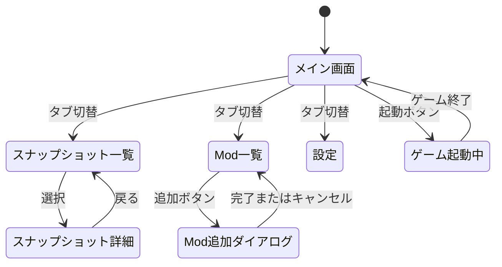
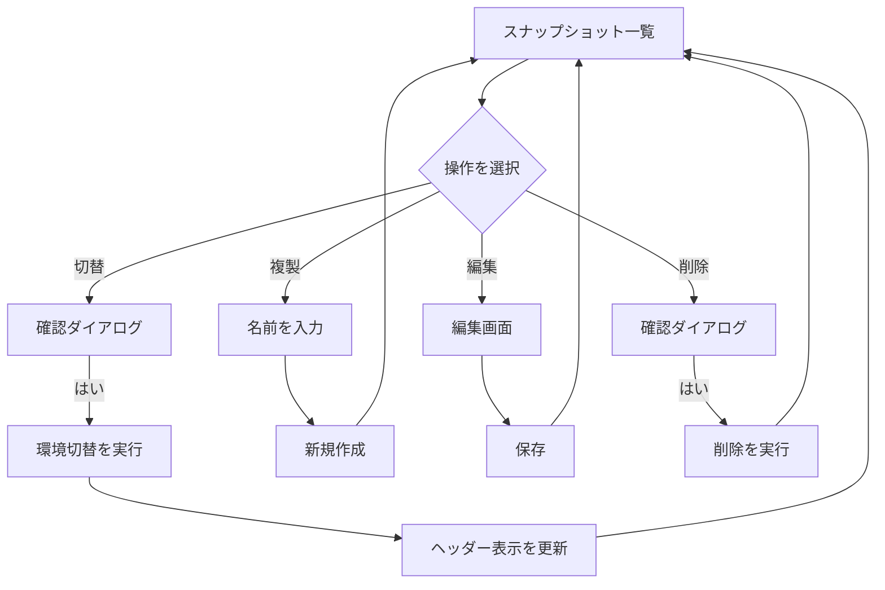
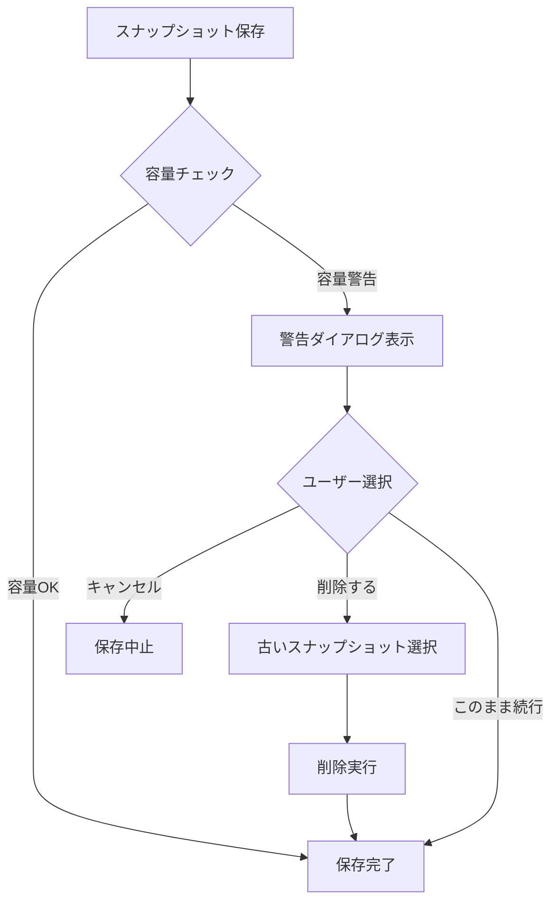

# Catalyzer UI ワイヤーフレーム設計書

> **バージョン**: 1.1.0
> **最終更新**: 2026-01-27
> **ステータス**: ドラフト

---

## 1. 現行UIの課題

### 1.1 状態が不明瞭

| 問題 | 詳細 |
|------|------|
| ゲームバージョン非表示 | 今どのバージョン（Stable/Experimental）で遊んでいるか分からない |
| Mod構成の全体像が見えない | 有効なModの数や状態が一目で分からない |
| プロファイル概念が曖昧 | 「プロファイル」がゲームバージョンとMod構成のどちらを指すのか不明確 |

### 1.2 git概念の露出

| 問題 | 詳細 |
|------|------|
| ブランチ・コミット概念 | ユーザーがgit知識を要求される設計 |
| 差分管理の複雑さ | 内部実装がUIに漏れている |

### 1.3 編集しづらい

| 問題 | 詳細 |
|------|------|
| 深いメニューネスト | プロファイル編集に3階層のドロップダウン |
| 操作の分散 | 関連操作が複数の場所に点在 |
| フィードバック不足 | 操作結果が分かりにくい |

---

## 2. 新UIの設計方針

### 2.1 コアコンセプト

```
┌─────────────────────────────────────────────────────────┐
│  「スナップショット」= ゲーム環境の"状態"               │
│                                                         │
│  ゲームバージョン + Mod構成 + 設定 = 1つのスナップショット │
└─────────────────────────────────────────────────────────┘
```

**保存方式**: フォルダコピー方式（B案）
- シンプルで確実な復元
- 容量は増えるが、管理が簡単

### 2.2 設計原則

| 原則 | 実現方法 |
|------|----------|
| **迷わず使える** | 主要操作は1クリック、最大2クリック |
| **状態が一目で分かる** | ヘッダーに常時表示、色分けで視覚的に区別 |
| **git知識不要** | 内部実装を完全に隠蔽、ユーザー向け用語のみ使用 |

### 2.3 用語の統一

| 旧用語 | 新用語 | 理由 |
|--------|--------|------|
| プロファイル | スナップショット | 「状態の保存」を直感的に表現 |
| ブランチ | （廃止） | git概念を排除 |
| コミット | （廃止） | git概念を排除 |

---

## 3. 画面設計

### 3.1 全体レイアウト

```
┌────────────────────────────────────────────────────────────┐
│ [ヘッダー] 現在の状態表示                                  │
├────────────────────────────────────────────────────────────┤
│                                                            │
│ [メインコンテンツ]                                         │
│                                                            │
│  - スナップショット一覧                                    │
│  - Mod一覧                                                 │
│  - 設定                                                    │
│                                                            │
├────────────────────────────────────────────────────────────┤
│ [フッター] アクションバー                                  │
└────────────────────────────────────────────────────────────┘
```

### 3.2 ヘッダー詳細

```
┌────────────────────────────────────────────────────────────┐
│ 🦀                                                         │
│ Catalyzer          [現在の状態]                            │
│                    ┌─────────────────────────────────────┐ │
│                    │ 🎮 Stable 0.I                       │ │
│                    │ 📦 日本語環境 (5個のMod)            │ │
│                    │ 💾 未保存の変更あり ●               │ │
│                    └─────────────────────────────────────┘ │
│                                        [▶ ゲーム起動]      │
└────────────────────────────────────────────────────────────┘
```

**ヘッダー要素**:
- ロゴ/アイコン
- 現在のゲームバージョン（Stable/Experimental + バージョン番号）
- 現在のMod構成名 + Mod数
- 変更状態インジケータ（保存済み/未保存）
- ゲーム起動ボタン（常時アクセス可能）

### 3.3 メインコンテンツ - タブ構成

```
┌─────────────────┬─────────────────┬─────────────────┐
│ 📸 スナップ     │   📦 Mod一覧    │   ⚙️ 設定       │
│    ショット     │                 │                 │
└─────────────────┴─────────────────┴─────────────────┘
```

---

## 4. ワイヤーフレーム

### 4.1 スナップショット一覧画面

```
┌────────────────────────────────────────────────────────────┐
│ 📸 スナップショット                      [+ 新規作成]      │
├────────────────────────────────────────────────────────────┤
│ 💾 使用容量: 1.2GB / 合計3件        [🧹 クリーンアップ]   │
├────────────────────────────────────────────────────────────┤
│                                                            │
│  ┌──────────────────────────────────────────────────────┐  │
│  │ ★ Stable 0.I + 日本語環境          [現在使用中]     │  │
│  │   🎮 Stable 0.I  📦 3個  📅 2026-01-27  💾 450MB    │  │
│  │   ─────────────────────────────────────────────────  │  │
│  │   [切替] [複製] [編集] [削除]                        │  │
│  └──────────────────────────────────────────────────────┘  │
│                                                            │
│  ┌──────────────────────────────────────────────────────┐  │
│  │   Experimental + Magiclysm                           │  │
│  │   🎮 Exp 2026-01-25  📦 8個  📅 2026-01-25  💾 520MB│  │
│  │   ─────────────────────────────────────────────────  │  │
│  │   [切替] [複製] [編集] [削除]                        │  │
│  └──────────────────────────────────────────────────────┘  │
│                                                            │
│  ┌──────────────────────────────────────────────────────┐  │
│  │   バニラ環境                                         │  │
│  │   🎮 Stable 0.H  📦 0個  📅 2025-12-01  💾 230MB    │  │
│  │   ─────────────────────────────────────────────────  │  │
│  │   [切替] [複製] [編集] [削除]                        │  │
│  └──────────────────────────────────────────────────────┘  │
│                                                            │
└────────────────────────────────────────────────────────────┘
```

**追加要素（容量関連）**:
- 使用容量の合計表示
- 各スナップショットの容量表示
- クリーンアップボタン

### 4.2 Mod一覧画面

```
┌────────────────────────────────────────────────────────────┐
│ 📦 Mod一覧                        [+ 追加] [🔄 更新]      │
├────────────────────────────────────────────────────────────┤
│ 🔍 検索...                                     [有効: 5]   │
├────────────────────────────────────────────────────────────┤
│                                                            │
│  ┌────┬────────────────────────────────────────┬────────┐  │
│  │ ✓  │ Magiclysm                              │ [削除] │  │
│  │    │ 魔法システムを追加する大型Mod          │        │  │
│  ├────┼────────────────────────────────────────┼────────┤  │
│  │ ✓  │ cata_jp（日本語化）                    │ [削除] │  │
│  │    │ 日本語翻訳                             │        │  │
│  ├────┼────────────────────────────────────────┼────────┤  │
│  │ ✓  │ Aftershock                             │ [削除] │  │
│  │    │ SFコンテンツ追加                       │        │  │
│  ├────┼────────────────────────────────────────┼────────┤  │
│  │    │ DinoMod                                │ [削除] │  │
│  │    │ 恐竜を追加（無効）                     │        │  │
│  └────┴────────────────────────────────────────┴────────┘  │
│                                                            │
│  📁 Modフォルダを開く                                      │
│                                                            │
└────────────────────────────────────────────────────────────┘
```

### 4.3 設定画面

```
┌────────────────────────────────────────────────────────────┐
│ ⚙️ 設定                                                    │
├────────────────────────────────────────────────────────────┤
│                                                            │
│  ┌────────────────────────────────────────────────────┐    │
│  │ 🎨 カラーテーマ                                    │    │
│  │ ┌──────┐ ┌──────┐ ┌──────┐ ┌──────┐               │    │
│  │ │ライト│ │ダーク│ │ 自動 │ │セピア│               │    │
│  │ └──────┘ └──────┘ └──────┘ └──────┘               │    │
│  └────────────────────────────────────────────────────┘    │
│                                                            │
│  ┌────────────────────────────────────────────────────┐    │
│  │ 🌐 言語                                            │    │
│  │ [ 日本語                                    ▼ ]    │    │
│  └────────────────────────────────────────────────────┘    │
│                                                            │
│  ┌────────────────────────────────────────────────────┐    │
│  │ 📂 ゲームバージョン管理                            │    │
│  │                                                    │    │
│  │   Stable 0.I        [ダウンロード済み]            │    │
│  │   Stable 0.H        [ダウンロード済み]            │    │
│  │   Experimental      [最新を取得]                  │    │
│  └────────────────────────────────────────────────────┘    │
│                                                            │
│  ┌────────────────────────────────────────────────────┐    │
│  │ 💾 ストレージ                                      │    │
│  │                                                    │    │
│  │   スナップショット使用量: 1.2GB（3件）            │    │
│  │   ┌────────────────────────────────┐              │    │
│  │   │████████████░░░░░░░░░░░░░░░░░░░│ 40%          │    │
│  │   └────────────────────────────────┘              │    │
│  │                                                    │    │
│  │   [🧹 古いスナップショットを削除]                 │    │
│  │   [📁 保存先フォルダを開く]                       │    │
│  └────────────────────────────────────────────────────┘    │
│                                                            │
└────────────────────────────────────────────────────────────┘
```

### 4.4 容量警告ダイアログ

```
┌────────────────────────────────────────────────────────────┐
│ ⚠️ 容量警告                                         [×]   │
├────────────────────────────────────────────────────────────┤
│                                                            │
│  スナップショットの使用容量が多くなっています。            │
│                                                            │
│  現在の使用量: 2.8GB（10件）                               │
│                                                            │
│  古いスナップショットを削除して容量を確保しますか？        │
│                                                            │
│  ┌────────────────────────────────────────────────────┐    │
│  │ □ バニラ環境 (2025-12-01)              230MB      │    │
│  │ □ テスト環境 (2025-11-15)              180MB      │    │
│  │ □ 旧Stable環境 (2025-10-01)            320MB      │    │
│  └────────────────────────────────────────────────────┘    │
│                                                            │
│  選択した項目を削除: 0MB                                   │
│                                                            │
│           [キャンセル]  [選択したものを削除]               │
│                                                            │
└────────────────────────────────────────────────────────────┘
```

---

## 5. 状態遷移図

### 5.1 メイン画面遷移



### 5.2 スナップショット操作フロー



### 5.3 容量管理フロー



---

## 6. 操作フロー

### 6.1 スナップショット保存フロー

```
ユーザー操作                          システム動作
─────────────────────────────────────────────────────
1. [現在の状態を保存] をクリック
                                      → 保存ダイアログを表示
2. スナップショット名を入力
   例: "Stable + 日本語Mod"
                                      → 入力を検証
3. [保存] をクリック
                                      → 容量をチェック
                                      → 現在の状態を保存
                                        - ゲームバージョンID
                                        - Modフォルダをコピー
                                        - 設定フォルダをコピー
                                        - セーブフォルダをコピー
                                      → 一覧に追加
                                      → 完了通知を表示
```

### 6.2 スナップショット復元フロー

```
ユーザー操作                          システム動作
─────────────────────────────────────────────────────
1. スナップショット一覧で
   [切替] をクリック
                                      → 確認ダイアログを表示
                                        「〇〇に切り替えますか？」
2. [はい] をクリック
                                      → 現在の変更を確認
                                        （未保存の場合は警告）
                                      → 環境を復元
                                        - ゲームバージョンを確認/DL
                                        - Modフォルダを復元
                                        - 設定フォルダを復元
                                        - セーブフォルダを復元
                                      → ヘッダー表示を更新
                                      → 完了通知を表示
```

### 6.3 Mod追加/削除フロー

```
【追加】
ユーザー操作                          システム動作
─────────────────────────────────────────────────────
1. [+ 追加] をクリック
                                      → 追加方法選択ダイアログ
                                        - ZIPファイルを選択
                                        - フォルダを選択
                                        - ドラッグ&ドロップ
2. ファイル/フォルダを選択
                                      → Mod情報を解析
                                      → 互換性をチェック
                                      → Modフォルダにコピー
                                      → 一覧を更新
                                      → 「未保存の変更あり」を表示

【削除】
1. Mod一覧で [削除] をクリック
                                      → 確認ダイアログ
2. [はい] をクリック
                                      → Modを削除
                                      → 一覧を更新
                                      → 「未保存の変更あり」を表示
```

### 6.4 容量クリーンアップフロー

```
ユーザー操作                          システム動作
─────────────────────────────────────────────────────
1. [🧹 クリーンアップ] をクリック
                                      → クリーンアップダイアログを表示
                                        - 全スナップショットを容量順に表示
                                        - 現在使用中は削除不可
2. 削除したい項目にチェック
                                      → 削除予定容量を計算して表示
3. [削除] をクリック
                                      → 確認ダイアログ
4. [はい] をクリック
                                      → 選択したスナップショットを削除
                                      → 容量表示を更新
                                      → 完了通知を表示
```

---

## 7. 比較表: 現行UI vs 新UI

| 観点 | 現行UI | 新UI |
|------|--------|------|
| **状態表示** | プロファイル名のみ | ゲームVer + Mod数 + 変更状態 + 容量 |
| **主要操作** | 3階層ドロップダウン | 1クリック |
| **用語** | プロファイル、ブランチ | スナップショット |
| **git概念** | 一部露出 | 完全隠蔽 |
| **ゲーム起動** | メニュー内 | ヘッダーに常時表示 |
| **Mod管理** | テーブル表示 | テーブル + 状態表示 |
| **編集操作** | ネストメニュー | インライン + ダイアログ |
| **フィードバック** | 少ない | 状態変化を明示 |
| **容量管理** | なし | 使用量表示 + クリーンアップ |

---

## 8. 実装優先度

### フェーズ1（必須）
1. ヘッダーの状態表示改善
2. スナップショット一覧画面
3. 基本的な切替機能

### フェーズ2（重要）
4. スナップショット保存/復元
5. Mod一覧の改善
6. 変更状態インジケータ
7. **容量表示機能**

### フェーズ3（推奨）
8. 設定画面のシンプル化
9. ゲームバージョン管理UI
10. **クリーンアップ機能**
11. アニメーション/トランジション

---

## 9. 補足: アイコン・色の意味

| アイコン | 意味 |
|----------|------|
| 🎮 | ゲームバージョン |
| 📦 | Mod/Mod構成 |
| 📸 | スナップショット |
| 💾 | 保存状態/容量 |
| ⚙️ | 設定 |
| ★ | 現在使用中 |
| 🧹 | クリーンアップ |
| ⚠️ | 警告 |
| ● (緑) | 保存済み |
| ● (黄) | 未保存の変更あり |
| ● (赤) | 容量警告 |
